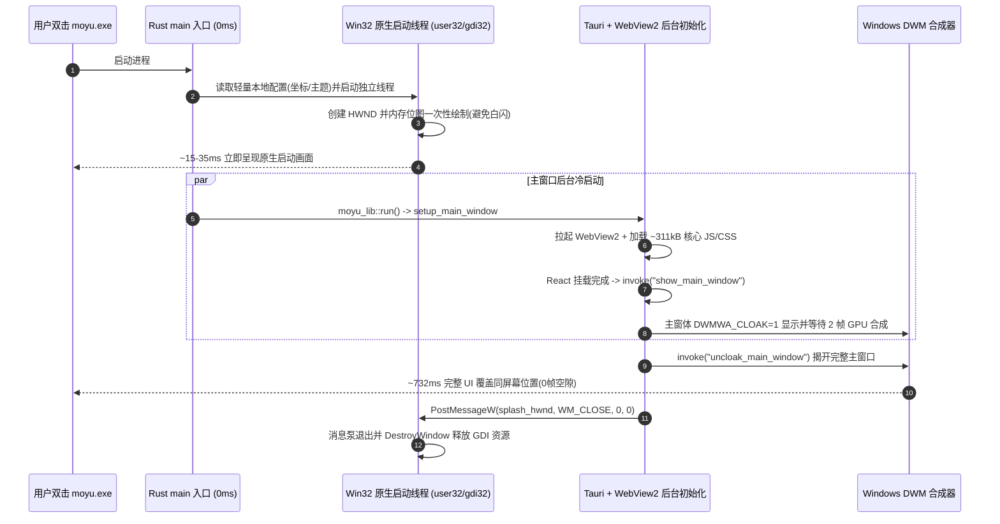

# 摩语 (MoYu) 启动界面（Splash Screen）架构设计与技术选型方案

## 1. 背景与目标

### 1.1 当前冷启动现状
经过前后端分包拆分、字体回退链优化及 DWM Cloak 首帧防白屏改造后，`MoYu` Windows Release 二进制（`moyu.exe`）的冷启动实测阶段耗时如下：

| 阶段 | 时间节点（双击启动起算） | 关键动作 |
| :--- | :--- | :--- |
| `T0 -> T1` | `0ms -> ~73ms` | OS 加载进程、Rust/Tauri 初始化、创建主窗口 `HWND` |
| `T1 -> T2` | `~73ms -> ~647ms` | 拉起并初始化多进程 WebView2 (`msedgewebview2.exe`)、加载前端核心分包 (`~311 kB` JS + CSS) 与 React 挂载 |
| `T2 -> T3` | `~647ms -> ~732ms` | `show_main_window` (DWM Cloak) + 等待 GPU 合成首帧 + `uncloak_main_window` 无闪烁揭开 |

### 1.2 核心痛点与目标
- **痛点**：虽然通过 DWM Cloak 已实现 `0ms` 白屏/黑屏闪现，但 `~732ms` 的桌面空窗等待期仍能让用户感知到“双击后略停顿才出窗口”。
- **用户诉求**：评估“双击后几毫秒至十几毫秒内先拉起启动界面，再切入主界面”的业界常见方案与 UX 权衡，判断是否适合 `MoYu` 以及应采用何种技术路线。

---

## 2. 业界方案对比与权衡

### 2.1 四种主流方案横向对比

| 维度 | 方案 A：Tauri 官方常规 WebView Splash（第二个 `WebviewWindow`） | 方案 B：纯 Rust 原生 Win32 居中独立小启动卡片 | 方案 C：纯 Rust 原生 Win32 同位同色轻量框架占位（VS Code / 微信 PC 风格） | 方案 D：维持现状（无启动界面，DWM Cloak 首帧直出） |
| :--- | :--- | :--- | :--- | :--- |
| **首次出现耗时** | **~500–650ms**（同样卡在 WebView2 启动） | **~15–40ms**（纯 OS 原生绘制） | **~15–40ms**（纯 OS 原生绘制） | **~732ms**（完整可交互界面） |
| **视觉连贯性** | ❌ 极差：先等半秒，再闪出不到 `150ms` 的小窗后切大窗 | ⚠️ 一般：居中卡片停留约 `680ms` 后跳变为 `1010×680` 主窗，短时应用易显突兀 | ✅ **极佳**：同坐标、同尺寸、同深浅底色+居中柔标原位接管，无大小跳变 | ✅ 极简直接：一击即完整界面，零二次过渡 |
| **零白屏/黑屏保障** | ❌ 易失控（子 WebView2 自身首帧亦可能白闪） | ✅ 100% 可控（原生 GDI/D2D 同步绘好再 `ShowWindow`） | ✅ 100% 可控（原生绘完即显，主窗就绪后零间隙替换） | ✅ 已实现（DWM Cloak） |
| **额外内存/进程开销** | ❌ 多开一个 WebView2 Renderer 进程 | ✅ 极低（仅单线程 Win32 GDI，销毁即回收） | ✅ 极低（仅单线程 Win32 GDI，销毁即回收） | ✅ 零额外开销 |
| **工程复杂度** | 低 | 中 | 中高（需读取上次窗口位置/尺寸与主题） | 最低 |

### 2.2 网传方案的核心误区澄清
网上大量 Tauri Splash 教程直接套用“在 `tauri.conf.json` 新增 `splashscreen` 窗口并关闭主窗口”的 WebView 方案（即 **方案 A**）。该方案在 Windows 上**无法实现“十几毫秒弹出”**：
1. Tauri 的第二个 `WebviewWindow` 底层依然要启动和挂载 `msedgewebview2.exe` 渲染上下文；
2. 对于本来就需要 3~5 秒初始化大型后端的软件，等 500ms 弹出 WebView Splash 再展示 3 秒有意义；但对于 `MoYu` 这种 **`~732ms` 就完成启动**的轻量工具，WebView Splash 自己要等 `~550ms` 才出现，闪现约 `150ms` 立刻关掉，体感反而像“弹窗闪退”。

### 2.3 UX 与技术选型结论
- **明确否决方案 A**：WebView2 无法满足十几毫秒拉起要求。
- **若追求“双击瞬间就有视觉响应”**：推荐 **方案 C（原生 Win32 同位同色占位窗）** 或 **方案 B（原生 Win32 轻量启动卡，圆角无边框卡片 + Logo/版本）**。
  - **为什么方案 C 更适合 `MoYu`**：对于 `< 1s` 的启动耗时，一个只停留 `0.65s` 的小卡片容易让眼睛产生“刚看清字就关了”的匆忙感；而同尺寸同位置的极简原生占位框架（仅柔和背景 + 中央轻量 Logo/应用名 + 窗口圆角阴影），在 `~20ms` 出现并在 `~730ms` 原位变为完整 UI，体感最接近原生桌面软件（类似 VS Code、微信、Notion 桌面端的秒开骨架体验），且可直接复用 `MoYu` 已有的窗口位置记忆体系。
- **若追求极简维护、不介意 0.7s**：保持 **方案 D**，同样干净无多余跳变。

---

## 3. 架构全景拓扑（方案 B / C：原生 Win32 零延迟启动层）

### 3.1 启动与无闪烁交接时序

### 3.2 原位交接的关键工程细节（防止“闪一下桌面”与跨线程陷阱）
1. **禁止跨线程直接调用 `DestroyWindow`**：网上部分示例直接在 Tauri `.setup()` 中调用 `DestroyWindow(splash_hwnd)`。Win32 规定 `DestroyWindow` 只能销毁当前线程创建的窗口，跨线程调用会静默失败；正确做法是由 Tauri 线程向占位窗线程发送 `PostMessageW(splash_hwnd, WM_CLOSE, 0, 0)`，由占位窗消息循环自身执行 `DestroyWindow` 与 `PostQuitMessage(0)`。
2. **先解封主窗口，再关占位窗（严禁颠倒）**：必须在 `uncloak_window_once` 完成、主窗口已由 DWM 真实呈现在屏幕最上层后，再异步发送 `WM_CLOSE` 关闭原生占位窗。这样即使两窗口切换瞬间也不可能露出哪怕 1 帧底层桌面或壁纸。
3. **先画再显，原生层也不能白闪**：Win32 占位窗创建时**不可**带 `WS_VISIBLE`，须在 `WM_PAINT`（或 `UpdateLayeredWindow` 离屏 `32-bit ARGB DIB`）准备好全部内容后，再一次性 `ShowWindow(SW_SHOWNOACTIVATE)` / `UpdateLayeredWindow`，确保原生窗自身也是 `0ms` 零白块。
4. **注意不要放在 `.setup()` 关闭**：`.setup()` 在 `~73ms` 时就已触发，此时 WebView2 还没加载前端。真正的关闭点应统一收敛在 [window_state.rs](file:///g:/Code/github/MoYu/src-tauri/src/window_state.rs) 的 `uncloak_window_once` 中（含 250ms 兜底与进程级安全超时保护，防止异常卡死）。

---

## 4. 环境与配置映射

### 4.1 跨平台与依赖策略
| 项目 | 说明 |
| :--- | :--- |
| **平台范围** | 仅 `#[cfg(target_os = "windows")]` 启用原生 Win32 启动窗；macOS / Linux 自动退化为空操作（保持各自原生窗口初始化路径）。 |
| **FFI 依赖** | 沿用 [window_state.rs](file:///g:/Code/github/MoYu/src-tauri/src/window_state.rs) 的零三方包轻量 `extern "system"` FFI 绑定模式（`user32.dll` / `gdi32.dll` / `dwmapi.dll`），避免引入完整 `windows` crate 拖慢 Release 编译体积与链接时长。 |
| **图片资产** | 使用 `include_bytes!` 在编译期将轻量预解码 BGRA 位图或小尺寸 PNG/BMP 嵌入二进制（无运行时磁盘路径依赖）。 |

### 4.2 几何坐标与深浅主题同步映射
为实现**方案 C（同位同色无缝占位）**且不引发“启动先白后黑”冲突，需要让 Rust 在 `Tauri` 插件初始化前即可在 `< 1ms` 内读取两项状态：
1. **窗口位置与最大化状态**：直接预读 `AppLocalData` / `AppData` 下既有持久化文件 `moyu-reader-settings.json` 中的窗口快照，并通过 `window_state.rs` 既有的 `resolve_restored_geometry` 计算目标物理坐标与大小（若开启记忆且有效则按记住的尺寸/最大化显示；否则居中 `1010×680`）。
2. **深浅色主题同步**：
   - 当前主题偏好保存在前端 `localStorage.getItem('theme')`（`'light' | 'dark' | 'system'`）。
   - 改造方案：前端在切换主题及初始化时，同步写入一份 `"theme"` 字段至 `moyu-reader-settings.json`（借助已有的 `@tauri-apps/plugin-store`）。
   - Rust 启动最顶部读取 `moyu-reader-settings.json` 的 `"theme"`（若为 `"system"` 或首次运行缺失，则直接查询 Windows 注册表 `HKCU\Software\Microsoft\Windows\CurrentVersion\Themes\Personalize\AppsUseLightTheme` 判断系统深浅色），原生背景色严格对齐主界面 `#ffffff` 与 `#1e1e1e`。

### 4.3 DPI 与用户设置项映射
- **DPI 感知**：原生启动线程创建前确保或读取目标显示器 DPI（`GetDpiForWindow` / 进程清单已开启 Per-Monitor V2），Logo 按 DPI 缩放居中，不发虚。
- **设置项预留**：如有需要，可在设置界面中与“记住窗口大小与位置”同级预留或默认启用启动过渡画面开关（存入 `moyu-reader-settings.json` 供原生入口读取）。

---

## 5. 实施步骤与落地计划

> [!IMPORTANT]
> 本章节为可选实施规划，需在确认采用 **方案 B（独立轻量启动卡）** 或 **方案 C（同位同色桌面占位框架）** 后再执行代码改动。

- **Phase 1：配置与资源预读抽离（纯 Rust）**
  - 新增 `src-tauri/src/startup_splash.rs`，实现纯内存 DIB/Layered Win32 启动窗及线程安全句柄管理（`AtomicIsize` + `PostMessageW(WM_CLOSE)`）。
  - 将主题同步持久化到 `moyu-reader-settings.json`（兼容老版本缺失字段自动回退系统深浅色），复用 `resolve_restored_geometry` 计算原生启动坐标。
- **Phase 2：嵌入品牌图标与高分屏自适应绘制**
  - 编译期嵌入固定高对比图标位图（浅色/深色主题背景适配或带透明通道的 `32-bit ARGB` 预乘位图，通过 `UpdateLayeredWindow` / `AlphaBlend` 绘制，自带抗锯齿边缘）。
  - 若采用方案 C，在顶部绘制 `32px` 逻辑高度原生背景标题条占位 + 中央柔和 `64×64` Logo 卡片。
- **Phase 3：生命周期挂接与异常兜底**
  - 在 `src-tauri/src/main.rs` 的 `moyu_lib::run()` 之前（`0–5ms` 窗口期）唤醒原生启动窗；
  - 在 `window_state.rs` 的 `uncloak_window_once` 解封后发送 `WM_CLOSE`；同时为原生线程增加最大兜底生存时间（如 `6s`）防止极端异常下残留悬浮框。
- **Phase 4：真实二进制全链路压测验证**
  - 使用高分辨率 Win32 探针采样：验证原生占位窗是否在 **`< 40ms`** 出现、主窗 `uncloak` 后是否 **`0帧`** 空洞交接、桌面无白屏/黑屏闪烁、关闭后进程树与 GDI 句柄完全释放。

---

## 6. 风险与回滚预案

| 风险点 | 防护措施 | 回滚策略 |
| :--- | :--- | :--- |
| **主窗口异常或 WebView2 启动失败导致启动图卡死桌面** | 原生线程内置独立守护定时器（如 6~8 秒自动 `WM_CLOSE`），且 `window_state.rs` 的 `6s` 强制显示兜底也会触发 `uncloak_window_once` 关闭启动图。 | 一键移除 `main.rs` 中的 `startup_splash::show()` 调用即可彻底恢复当前 DWM Cloak 直出逻辑，零破坏既有窗口状态系统。 |
| **主题不一致导致原生图和主界面颜色跳变** | 前端同步写入 `moyu-reader-settings.json`；默认 `'system'` 与 Windows `AppsUseLightTheme` 保持同一判断基准。 | 若读取失败统一回退系统主题色；或改用独立中性半透明居中图标卡片（方案 B）规避整窗颜色切换。 |
| **多屏/高 DPI 下计算坐标偏差** | 直接复用已通过单元测试的 `resolve_restored_geometry`，并在方案 B 中居中至主显示器或鼠标所在显示器工作区。 | 方案 B 无需依赖复杂窗体坐标，回退成本极低。 |
| **未来若接入单实例插件（`single-instance`）引发二次双击闪烁** | 若后续接入单实例锁，务必在创建单实例互斥锁**并确认自身是首实例之后**再弹出原生启动窗。 | 架构文档已在拓扑顺序中显式约束启动优先级。 |

---

## 7. 跨平台综合评估与最终决策（采纳方案 D）

结合项目在 [.github/workflows/release.yml](file:///g:/Code/github/MoYu/.github/workflows/release.yml) 中同时面向 **4 个目标平台**发布（`aarch64-apple-darwin`、`x86_64-apple-darwin`、`x86_64-unknown-linux-gnu`、`x86_64-pc-windows-msvc`），综合比较各平台机制后，最终决定**采纳方案 D（无原生启动图、全平台统一首帧就绪直出）**：

1. **三端原生实现高度割裂**：Windows 依赖 Win32 GDI/Direct2D、macOS 需桥接 Cocoa `NSWindow`（且 macOS 本身有 Dock 反馈且 WKWebView 起步更快）、Linux 则面临 X11 与 Wayland（Wayland 禁止客户端自行居中/指定窗口绝对坐标）碎片化问题，维护成本与平台特例 Bug 风险明显偏高。
2. **方案 D 架构高度统一且三端同享前端优化**：
   - 全平台复用同一套前端按需分包、`Logo` 轻量化、字体栈优化与“首帧挂载完成再显示窗口”的统一生命周期；
   - 仅 Windows 通过 [window_state.rs](file:///g:/Code/github/MoYu/src-tauri/src/window_state.rs) 中的 `#[cfg(target_os = "windows")]` DWM Cloak 消除硬件合成首帧闪白，macOS / Linux 则自然走 `#[cfg(not(target_os = "windows"))]` 零原生依赖路径。
3. **当前约 `732ms` 冷启动已达轻量桌面工具良好体验区间**：兼顾跨平台一致性、代码简洁度与 0ms 白屏/黑屏表现，若后续有强需求可随时按第 3~5 节设计仅针对 Windows 增量启用原生启动层。
