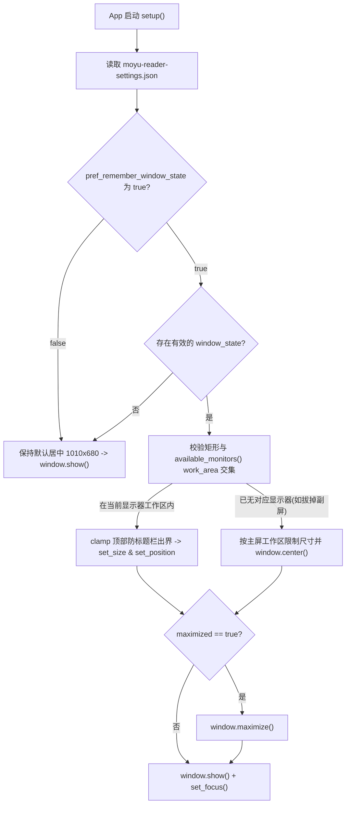
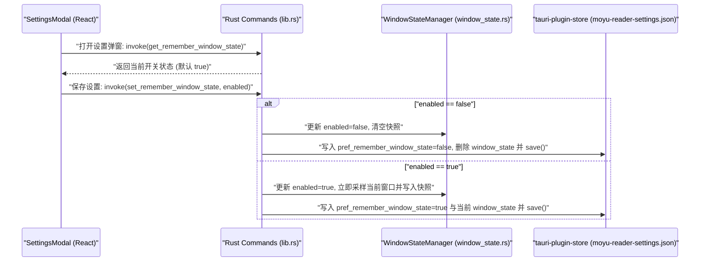

# 摩语 (MoYu) 窗口状态持久化方案设计文档

> **状态**：已定稿（Plan B）  
> **适用端**：Tauri v2 Desktop (Windows / macOS / Linux)  
> **关联模块**：`src-tauri/src/window_state.rs`、`src-tauri/src/lib.rs`、`src-tauri/tauri.conf.json`、`src/components/SettingsModal.jsx`、`src/utils/store.js`、`src/i18n/locales.js`

---

## 1. 背景与目标

### 1.1 需求背景
目前 MoYu 主窗口在 [tauri.conf.json](file:///g:/Code/github/MoYu/src-tauri/tauri.conf.json#L14-L28) 中固定配置为 `width: 1010, height: 680, center: true, decorations: false`。用户将窗口最大化或调整至习惯的位置和尺寸后，关闭应用再重新启动时都会被重置回初始状态。

由于 MoYu 已在 [SettingsModal.jsx](file:///g:/Code/github/MoYu/src/components/SettingsModal.jsx#L49-L60) 与 [App.jsx](file:///g:/Code/github/MoYu/src/App.jsx#L50-L65) 中提供“恢复上次退出的页面”，并在 [store.js](file:///g:/Code/github/MoYu/src/utils/store.js) 中持久化了阅读进度，窗口状态缺失记忆会导致桌面使用连续性被割裂。

### 1.2 核心目标
1. **完整记忆窗口形态**：持久化非最大化状态下的普通几何信息（`x, y, width, height`）以及 `maximized` 标志位；最大化状态下关闭再启动可自动以最大化打开，点击“还原”可回到之前习惯的尺寸与位置。
2. **启动无闪烁**：在 Rust 侧完成窗口状态恢复后再显示主窗口，杜绝“先闪出默认小窗再突然最大化”的视觉跳变。
3. **跨屏幕与边界安全**：校验历史坐标是否仍在当前可用显示器工作区（`work_area`）内；外接副屏断开时自动回退至主屏安全位置，避免窗口或无边框标题栏跑出屏幕外。
4. **用户可控（默认开启）**：在全局偏好设置弹窗的“启动行为”下提供“记住窗口大小与位置（含最大化状态）”复选框，默认勾选。

---

## 2. 方案对比与权衡

| 评估维度 | 方案 A：`tauri-plugin-window-state` | 方案 B：复用 `tauri-plugin-store` + Rust 窗口事件（选用） |
| :--- | :--- | :--- |
| **依赖引入** | 需新增 Rust crate、前端 npm 包及 capabilities 权限 | 零新增第三方依赖，直接复用已有的 `tauri-plugin-store` |
| **配置文件** | 插件独立生成 `.window-state.json`，与现有配置分散 | 与阅读进度统一存于 `moyu-reader-settings.json` |
| **开关控制** | 需额外桥接 `AtomicBool` + `.with_filter(...)`，与自动显隐逻辑易产生协调成本 | 原生受控：Rust 启动同步读开关，开关切换通过命令即时同步并清理/重建快照 |
| **无边框/跨平台控制** | 对 `decorations: false` 下的细节调整受限于插件内部实现 | 核心逻辑约百行 Rust 代码，精确控制最小尺寸、最小化忽略、全屏忽略及标题栏防越界 clamp |

**选型结论**：MoYu 为单主窗口无边框应用，且项目已接入 `tauri-plugin-store` 并需要动态配置开关，因此 **方案 B** 在架构整洁度、开关一致性与边界可控性上更优。

---

## 3. 架构全景拓扑

### 3.1 启动恢复与运行期同步流程

### 3.2 运行期事件与开关联动

---

## 4. 环境与配置映射

### 4.1 持久化文件与字段映射

复用系统应用数据目录下的 `moyu-reader-settings.json`（与 [store.js](file:///g:/Code/github/MoYu/src/utils/store.js#L4) 共享同一个 `Store` 实例）：

| 存储键名 | 类型 | 默认值 | 说明 |
| :--- | :--- | :--- | :--- |
| `pref_remember_window_state` | `boolean` | `true` | 是否启用“记住上次窗口大小与位置（含最大化状态）” |
| `window_state` | `object` / 不存在 | 无 | 窗口物理坐标与状态：`{ x: i32, y: i32, width: u32, height: u32, maximized: bool }` |

> **像素单位约定**：与 Tauri v2 窗口及显示器 API 对齐，几何字段统一使用**物理像素**（`PhysicalPosition<i32>` 与 `PhysicalSize<u32>`），避免高 DPI 缩放下出现尺寸漂移。

### 4.2 前端降级兼容

在纯浏览器预览模式（非 Tauri 运行时，无法调用 `invoke`）下，通过 `localStorage` 中的 `pref_remember_window_state` 键值做平滑降级读写，保证设置弹窗在 Web 预览环境下不报错。

### 4.3 关键配置变更

- [src-tauri/tauri.conf.json](file:///g:/Code/github/MoYu/src-tauri/tauri.conf.json)：主窗口配置增加 `"visible": false`，由 Rust `setup()` 阶段恢复窗口位置/尺寸/最大化状态后统一调用 `window.show()`，消除冷启动闪屏。

---

## 5. 实施步骤与落地计划

1. **后端状态模块 (`src-tauri/src/window_state.rs`)**
   - [x] 定义 `PersistedWindowState` 与受 `Arc<Mutex<...>>` / `Arc<AtomicBool>` 保护的 `WindowStateManager`
   - [x] 实现工作区几何校验与安全恢复逻辑（过滤最小化/全屏、最大化时不覆盖普通尺寸、多显示器交集判定与顶部 clamp、副屏断开回退主屏居中）
   - [x] 实现窗口事件监听（`Resized` / `Moved` 防抖异步落盘 + `CloseRequested` 同步落盘）
   - [x] 暴露 `get_remember_window_state` 与 `set_remember_window_state` 两个 Tauri Command
   - [x] 为纯几何计算、边界 clamp 与状态机转换补充 Rust 单元测试
2. **后端装配 (`src-tauri/src/lib.rs` & `src-tauri/tauri.conf.json`)**
   - [x] 主窗口启用 `"visible": false`
   - [x] 在 `lib.rs` 中注册 `WindowStateManager` 状态、命令和 `setup()` 恢复/事件绑定逻辑（确保无论恢复成功与否最终必执行 `window.show()`）
3. **前端设置与多语言 (`src/utils/store.js`, `src/components/SettingsModal.jsx`, `src/i18n/locales.js`)**
   - [x] 在 `locales.js` 中增加中英文文案 `settings.startup.rememberWindow`
   - [x] 在 `store.js` 中封装 `loadRememberWindowState` / `saveRememberWindowState`（含非 Tauri 环境降级处理）
   - [x] 在 `SettingsModal.jsx` 的“启动行为”区块下增加默认勾选的复选框并在保存时同步
4. **测试与校验**
   - [x] 新增前端偏好读写单元测试并接入 `tests/run_tests.js`
   - [x] 执行 `cargo test`、`pnpm run lint`、`pnpm test`、`pnpm run build` 验证无编译/测试/打包回归

---

## 6. 风险与回滚预案

| 风险点 | 防护措施 | 回滚预案 |
| :--- | :--- | :--- |
| **`visible: false` 导致窗口无法显示** | `setup()` 中所有恢复逻辑均使用容错降级处理，不使用 `?` 提前退出；恢复函数结束前无条件调用 `window.show()` | 移除 `tauri.conf.json` 中的 `"visible": false` 即可立即恢复默认直接显示 |
| **损坏或极端的窗口尺寸数据** | 反序列化后强制校验宽高下限（如 `width >= 400 && height >= 300`），并受 `tauri.conf.json` `minWidth: 800, minHeight: 600` 约束 | 删除用户数据目录中 `moyu-reader-settings.json` 内的 `window_state` 键或关闭设置开关 |
| **最大化时误覆盖普通窗口尺寸** | `Resized` / `Moved` 仅在 `!is_maximized && !is_minimized && !is_fullscreen` 时更新 `x/y/width/height`；最大化时仅翻转 `maximized = true` | 可直接退回未启用窗口状态监听的 `lib.rs` 版本 |
| **高频率拖拽窗口引发频繁磁盘 I/O** | 移动/缩放仅更新内存快照并触发 500ms 防抖保存，关闭时执行一次最终同步落盘 | 可随时将防抖落盘改为仅 `CloseRequested` 落盘 |
